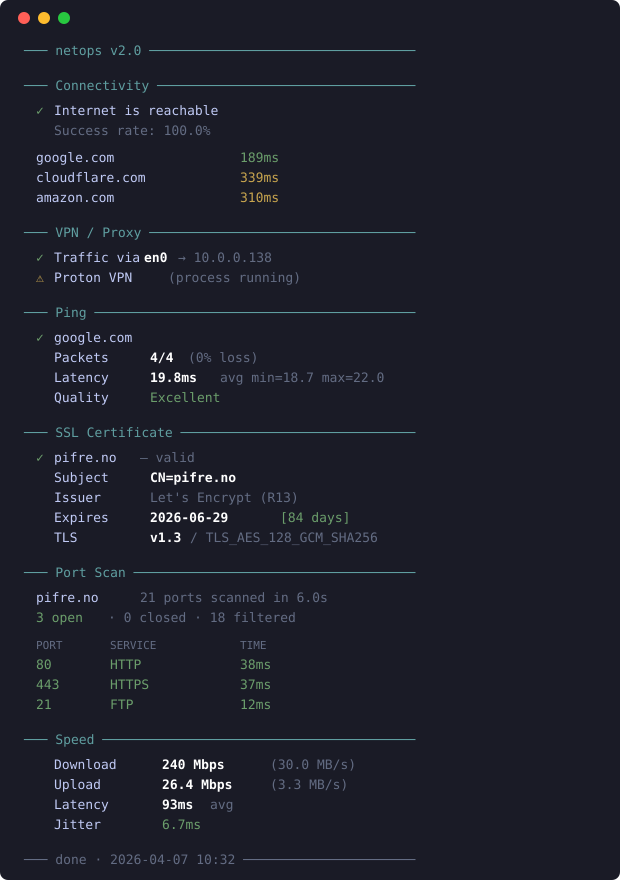

# netops

A fast network diagnostics CLI. One command to check connectivity, speed, DNS, ports, certificates, VPN status, and more.

Built for developers and sysadmins who want quick answers without opening a browser.

<p align="center">
  
</p>

## Install

```bash
npm install -g github:Salberg87/netops
```

## Quick start

```bash
# Full diagnostic suite (~30-60s)
netops full

# Quick health check without speed test (~10s)
netops diagnose

# Just check if internet works
netops check
```

## Commands

### Connectivity & Speed

| Command | Description |
|---------|-------------|
| `netops check` | Quick connectivity check against multiple endpoints |
| `netops speed` | Download + upload speed test with latency |
| `netops speed -d` | Download only |
| `netops speed -u` | Upload only |
| `netops latency -c 20` | Latency test with jitter and standard deviation |

### DNS

| Command | Description |
|---------|-------------|
| `netops dns example.com` | A record lookup |
| `netops dns example.com -t MX` | Specific record type (A, AAAA, MX, TXT, CNAME, NS) |
| `netops dns example.com -a` | All record types |
| `netops rdns 8.8.8.8` | Reverse DNS lookup |
| `netops dns-speed` | DNS server response time |

### Network

| Command | Description |
|---------|-------------|
| `netops ping google.com` | Ping with packet loss and quality rating |
| `netops ping google.com -c 10` | Custom packet count |
| `netops trace google.com` | Traceroute — see where packets go |
| `netops iface` | Network interfaces and IP addresses |
| `netops route` | Routing table and default gateway |

### Security & Ports

| Command | Description |
|---------|-------------|
| `netops ports example.com` | Scan common ports (21 services) |
| `netops ports example.com -p 80,443,8080` | Scan specific ports |
| `netops ports example.com -p 1-1024` | Scan port range |
| `netops cert example.com` | SSL certificate details (expiry, chain, TLS version) |
| `netops cert example.com -p 8443` | Check certificate on custom port |

### Lookup

| Command | Description |
|---------|-------------|
| `netops whois example.com` | Domain registration info and expiry |
| `netops http https://example.com` | HTTP response test with timing |
| `netops http https://example.com -m POST` | Custom HTTP method |

### Detection

| Command | Description |
|---------|-------------|
| `netops vpn` | Detect active VPN and proxy connections |
| `netops wifi` | WiFi signal strength, channel, noise, SNR |

### AI & Reporting

| Command | Description |
|---------|-------------|
| `netops report` | Generate markdown report (for piping to LLMs) |
| `netops ask` | Run diagnostics and ask Claude to analyze |
| `netops ask "why is my jitter high?"` | Ask a specific question |

### Composite

| Command | Description |
|---------|-------------|
| `netops diagnose` | Full diagnostics without speed test |
| `netops full` | Everything including speed test |

## AI-powered diagnostics

```bash
# Let Claude analyze your network
netops ask

# Ask a specific question
netops ask "why is my jitter so high?"

# Pipe to any LLM
netops report | claude -p "analyze this"
netops report | llm "what's wrong?"
```

## JSON output

All commands support `--json` for scripting and piping:

```bash
netops --json cert example.com
netops --json speed
netops --json vpn | jq '.vpns'
```

## What it detects

**VPN/Proxy** — Proton VPN, NordVPN, ExpressVPN, Mullvad, Tailscale, WireGuard, OpenVPN, Cloudflare WARP, and system proxy settings. Also checks if default route goes through a tunnel interface.

**Ports** — 21 common services: FTP, SSH, SMTP, DNS, HTTP/S, POP3, IMAP, MySQL, PostgreSQL, Redis, VNC, and dev servers.

**WiFi** — RSSI, noise floor, SNR, channel, and signal quality. Works on macOS, Linux, and Windows.

## Requirements

- Node.js 18+
- Works on macOS, Linux, and Windows

## Dependencies

- [Commander](https://github.com/tj/commander.js) — CLI framework
- [Chalk](https://github.com/chalk/chalk) — Terminal colors
- [Ora](https://github.com/sindresorhus/ora) — Spinners

No native dependencies.

## License

MIT
