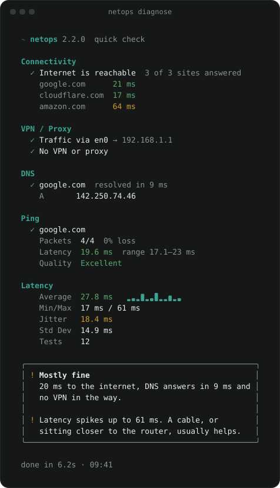

# netops

[](https://github.com/Salberg87/netops/actions/workflows/ci.yml)
[](LICENSE)

Open-source network diagnostics for humans **and for Claude**.

- **A CLI** — one command to check connectivity, speed, DNS, ports, certificates, VPN status, Wi-Fi and more.
- **A skill bundle** — four Claude skills that teach Claude *how* to troubleshoot a network: what to run, which numbers matter, and how to localise the fault.
- **A Claude Code mod** — tools Claude can call directly (`mcp__netops__diagnose`, `mcp__netops__run`), a `/netops` health pane, and a status-line indicator.

<p align="center">
  
</p>

## Install in Claude Code

At the prompt of a Claude Code terminal session:

```
/plugin install netops --marketplace Salberg87/netops
```

Answer `y` to add the marketplace, then pick a scope. From a shell instead:

```bash
claude plugin install netops --marketplace Salberg87/netops
```

In the desktop app, where `/plugin` does not run: click **+** next to the prompt box → **Plugins** → **Add marketplace** with `Salberg87/netops` → **Add plugin**.

Requires Node.js 20+ on the machine. Dependencies are installed automatically the first time netops runs.

Then just talk to Claude:

> my internet feels slow today — what's going on?
>
> when does the cert on example.com expire, and is the chain OK?
>
> is port 5432 open on my staging box?

Or type `/netops` to open the network health pane.

### What's in the plugin

| | Name | What it does |
| --- | --- | --- |
| Skill | `network-troubleshooting` | Outside-in playbook for slow/flaky/down connections: connectivity → VPN → DNS → loss/latency/jitter → Wi-Fi/throughput |
| Skill | `dns-debugging` | Missing or wrong records, propagation, MX/SPF/DMARC/DKIM, slow resolvers, reverse DNS |
| Skill | `tls-and-http` | Certificate expiry, SANs, chain and TLS version; HTTP status and timing |
| Skill | `port-and-route-checks` | Open/closed/filtered ports (with an authorisation check), traceroute, routes, interfaces, VPN routes |
| Tool | `mcp__netops__diagnose` | Runs the full suite and returns JSON with `issues` and `status` (optional speed test) |
| Tool | `mcp__netops__run` | Runs one netops command with validated arguments |
| Command | `/netops` | Opens the **Network health** pane: verdict, ping, jitter, DNS, VPN, issues, *Refresh* and *With speed test* buttons |
| Status line | `net ✓ 14ms` | Latest result, updated after each run |

The skills work on their own too (they fall back to the bundled CLI through Bash), so they are useful in any Claude environment that loads skills.

### How it fits together

```
 you ──▶ Claude ──▶ skill (what to check, how to read it)
                      │
                      ▼
                 mod tools  mcp__netops__diagnose / run   ──▶ /netops pane + status line
                      │
                      ▼
              scripts/netops --json <command>   (validated argv, no shell)
                      │
                      ▼
                 netops CLI (index.js, lib/)
```

## Install the CLI

```bash
npm install -g github:Salberg87/netops
```

## Quick start

```bash
# Full diagnostic suite (~30-60s)
netops full

# Quick health check without speed test (~10s)
netops diagnose

# Just check if internet works
netops check
```

## CLI commands

### Connectivity & Speed

| Command | Description |
|---------|-------------|
| `netops check` | Quick connectivity check against multiple endpoints |
| `netops speed` | Download + upload speed test with latency |
| `netops speed -d` | Download only |
| `netops speed -u` | Upload only |
| `netops latency -c 20` | Latency test with jitter and standard deviation |

### DNS

| Command | Description |
|---------|-------------|
| `netops dns example.com` | A record lookup |
| `netops dns example.com -t MX` | Specific record type (A, AAAA, MX, TXT, CNAME, NS) |
| `netops dns example.com -a` | All record types |
| `netops rdns 8.8.8.8` | Reverse DNS lookup |
| `netops dns-speed` | DNS server response time |

### Network

| Command | Description |
|---------|-------------|
| `netops ping google.com` | Ping with packet loss and quality rating |
| `netops ping google.com -c 10` | Custom packet count |
| `netops trace google.com` | Traceroute — see where packets go |
| `netops iface` | Network interfaces and IP addresses |
| `netops route` | Routing table and default gateway |

### Security & Ports

| Command | Description |
|---------|-------------|
| `netops ports example.com` | Scan common ports (21 services) |
| `netops ports example.com -p 80,443,8080` | Scan specific ports |
| `netops ports example.com -p 1-1024` | Scan port range |
| `netops cert example.com` | SSL certificate details (expiry, chain, TLS version) |
| `netops cert example.com -p 8443` | Check certificate on custom port |

### Lookup

| Command | Description |
|---------|-------------|
| `netops whois example.com` | Domain registration info and expiry |
| `netops http https://example.com` | HTTP response test with timing |
| `netops http https://example.com -m POST` | Custom HTTP method |

### Detection

| Command | Description |
|---------|-------------|
| `netops vpn` | Detect active VPN and proxy connections |
| `netops wifi` | WiFi signal strength, channel, noise, SNR |

### AI & Reporting

| Command | Description |
|---------|-------------|
| `netops report` | Generate markdown report (for piping to LLMs) |
| `netops report --speed` | Report including a speed test |
| `netops --json report` | Structured JSON with `issues` and overall `status` |
| `netops ask` | Run diagnostics and ask Claude to analyze |
| `netops ask "why is my jitter high?"` | Ask a specific question |

### Composite

| Command | Description |
|---------|-------------|
| `netops diagnose` | Full diagnostics without speed test |
| `netops full` | Everything including speed test |

## AI-powered diagnostics without the plugin

```bash
# Let Claude analyze your network
netops ask

# Ask a specific question
netops ask "why is my jitter so high?"

# Pipe to any LLM
netops report | claude -p "analyze this"
netops report | llm "what's wrong?"
```

## JSON output

All commands support `--json` for scripting and piping. Spinners and banners never touch stdout in this mode:

```bash
netops --json cert example.com
netops --json diagnose | jq '.issues'
netops --json vpn | jq '.vpns'
```

## What it detects

**VPN/Proxy** — Proton VPN, NordVPN, ExpressVPN, Mullvad, Tailscale, WireGuard, OpenVPN, Cloudflare WARP, and system proxy settings. Also checks if default route goes through a tunnel interface.

**Ports** — 21 common services: FTP, SSH, SMTP, DNS, HTTP/S, POP3, IMAP, MySQL, PostgreSQL, Redis, VNC, and dev servers.

**WiFi** — RSSI, noise floor, SNR, channel, and signal quality. Works on macOS, Linux, and Windows.

## Security and responsible use

- Hosts, URLs, counts and port lists are validated, and system tools (`ping`, `traceroute`, `whois`) are run with an argument vector, never through a shell. The mod validates every argument again before calling the CLI.
- The mod's HTTP check only allows `GET`, `HEAD` and `OPTIONS`.
- Only scan ports on hosts you own or are authorised to test. The `port-and-route-checks` skill tells Claude to ask first.
- Found a vulnerability? See [SECURITY.md](SECURITY.md).

## Development

```bash
git clone https://github.com/Salberg87/netops && cd netops && npm install
npm test                    # CLI unit tests
claude plugin validate .    # plugin manifest, skills, mod
claude plugin test .        # mod tests
claude --plugin-dir .       # run Claude Code with your working copy
```

Repository layout:

```
.claude-plugin/   plugin.json + marketplace.json
skills/           the four Claude skills (SKILL.md each)
hooks/            the mod: register.tsx (tools, /netops pane, status line)
types/            the mod's $.state contract
scripts/netops    bootstrap wrapper the skills and mod call
index.js, lib/    the CLI
test/, tests/     CLI tests (node:test), mod tests (claude plugin test)
```

Contributions are welcome — read [CONTRIBUTING.md](CONTRIBUTING.md) and the [Code of Conduct](CODE_OF_CONDUCT.md).

## Requirements

- Node.js 20+
- macOS, Linux or Windows (the `scripts/netops` wrapper used by the plugin needs a POSIX `sh`; on Windows use WSL or Git Bash)
- Claude Code for the plugin

## Dependencies

- [Commander](https://github.com/tj/commander.js) — CLI framework
- [Chalk](https://github.com/chalk/chalk) — Terminal colors
- [Ora](https://github.com/sindresorhus/ora) — Spinners

No native dependencies.

## License

[MIT](LICENSE)
